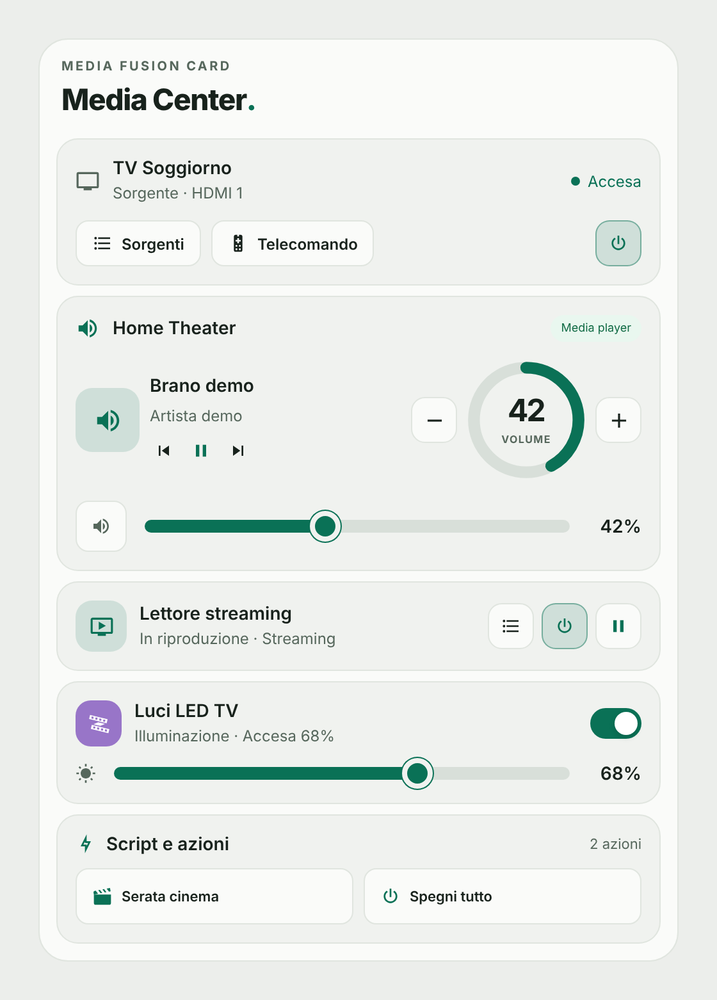
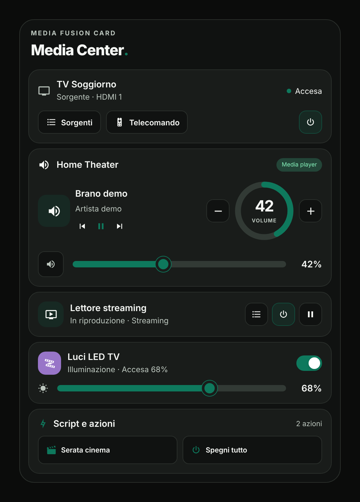
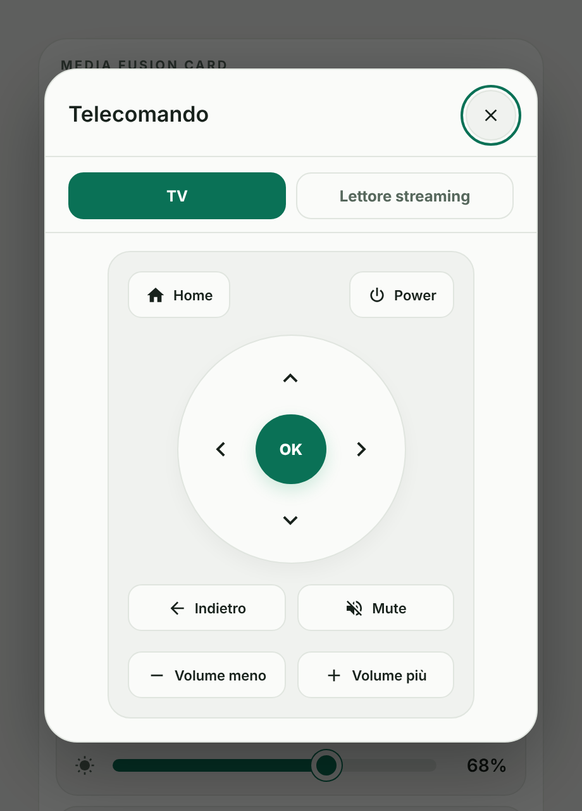

# Media Fusion Card

[](https://www.tiktok.com/@luigi.regolo)
[](LICENSE)
[](https://my.home-assistant.io/redirect/hacs_repository/?owner=luigi-regolo&repository=media-fusion-card&category=plugin)
[](https://github.com/luigi-regolo/media-fusion-card/stargazers)

## Overview

**Media Fusion Card** is a modular dashboard card for Home Assistant that brings the controls of a media setup into one place: TV, streaming player, home theater audio, LED lighting and custom scripts. It uses a minimalist interface inspired by the Edera Light and Dark visual styles.

Each section can be shown or hidden, and every control appears only when the configured entity can actually perform it. When a device is unavailable or does not support a function, the card says so instead of showing a button that does nothing.

The card works with the entities already available in Home Assistant. It does not require a dedicated account, external services or additional libraries.

## Preview







*Previews use fictional demo data. The interface text is currently in Italian.*

## Features

- **TV:** Power button, source selection popup and remote control popup. Power uses the on/off scripts you configure, or the entity's own turn on/off when the entity supports it.
- **Streaming player:** Power, play/pause, application or source selection and remote control popup. Optional power through Android Debug Bridge (ADB).
- **Home theater audio:** Now playing information with artwork, play/pause, previous/next track, mute, circular volume indicator, volume slider and volume buttons. The last volume set from the card is remembered in the browser when the entity does not report its volume level.
- **LED lighting:** On/off switch and brightness slider that sends the value while you move it. The indicator shows the real light colour when available.
- **Scripts:** A grid of custom actions with their friendly names and a running state.
- **Clear states:** Unavailable, unknown and unsupported states are described in plain words.
- **Visual configuration:** Configure the card through the Home Assistant dashboard editor, without writing YAML. The editor includes a diagnostics view that shows which functions each entity supports.
- **Edera appearance:** Automatic, Light and Dark themes with Home Assistant Material Design Icons.
- **Responsive layout:** A responsive interface for desktop, smartphone and tablet dashboards, with an optional compact layout.

## Installation

### HACS — Custom repository

[](https://my.home-assistant.io/redirect/hacs_repository/?owner=luigi-regolo&repository=media-fusion-card&category=plugin)

1. Open **HACS** in Home Assistant.
2. Open the menu and select **Custom repositories**.
3. Enter the repository URL:

   `https://github.com/luigi-regolo/media-fusion-card`

4. Select **Dashboard** as the repository type and add it.
5. Find **Media Fusion Card** in HACS and download it.
6. Reload the Home Assistant dashboard if necessary.
7. Add the card using the visual editor.

The repository contains `hacs.json` and the distributable JavaScript module `dist/media-fusion-card.js`.

### Manual installation

1. Download `dist/media-fusion-card.js` from the GitHub repository.
2. Copy it to the `www` directory of your Home Assistant configuration as `media-fusion-card.js`.
3. Open **Settings → Dashboards → Resources** in Home Assistant.
4. Add the following resource:

   `/local/media-fusion-card.js`

5. Select **JavaScript module** as the resource type.
6. Reload the dashboard and add the card.

If the `www` directory was just created, Home Assistant may need to be restarted before the file becomes accessible.

## Configuration and Usage

### Visual editor

Open a dashboard in edit mode, add **Media Fusion Card** and configure it. The editor has three sections:

- **Sezioni:** choose which sections to show (TV, streaming player, home theater, LED lighting, scripts).
- **Aspetto:** title, header label, theme, layout and artwork source.
- **Azioni:** entities, remote entities, power scripts, custom scripts and the diagnostics view.

### Example YAML configuration

The card can be configured entirely through the visual editor. The following example uses fictional entity identifiers:

```yaml
type: custom:media-fusion-card
title: Media Center
tv_entity: media_player.tv_demo
tv_remote: remote.tv_demo
tv_off_script: script.spegni_tv_demo
audio_entity: media_player.audio_demo
streaming_entity: media_player.streaming_demo
streaming_remote: remote.streaming_demo
light_entity: light.luci_demo
scripts:
  - name: Serata cinema
    entity_id: script.serata_cinema_demo
```

### Main configuration options

| Option | Description |
|---|---|
| `title` | Main card title. Default: `Media Center`. |
| `subtitle` | Secondary line, shown when `show_subtitle` is `true`. |
| `show_title`, `show_eyebrow`, `show_subtitle` | Show the title, the small header label and the subtitle. |
| `theme` | `auto`, `light` or `dark`. Default: `auto`. |
| `compact_mode` | Reduce spacing without removing controls. Default: `false`. |
| `show_tv`, `show_streaming`, `show_audio`, `show_light`, `show_scripts` | Show or hide the TV, streaming player, home theater, lighting and scripts sections. Default: `true`. |
| `tv_entity` | `media_player` entity of the TV. |
| `tv_remote` | `remote` entity used by the TV remote control popup. |
| `tv_on_script`, `tv_off_script` | Optional `script` entities used to turn the TV on and off. |
| `streaming_entity` | `media_player` entity of the streaming player. |
| `streaming_remote` | `remote` entity used by the streaming player remote control popup. |
| `streaming_adb_power` | Use ADB `WAKEUP` and `SLEEP` commands (`androidtv.adb_command`) for the streaming player power button. Default: `false`. |
| `audio_entity` | `media_player` entity of the home theater audio. |
| `light_entity` | `light` entity of the LED lighting. |
| `scripts` | List of custom actions, each with `entity_id` (a `script` entity) and an optional `name`. Up to 30. |
| `tv_name`, `streaming_name`, `audio_name`, `light_name` | Custom display names for each section. |
| `tv_headline` | Optional main text shown in the TV section. Empty hides it. |
| `artwork_source` | Artwork shown with the audio section: `audio`, `streaming` or `none`. Default: `audio`. |

## Compatibility and Requirements

- Home Assistant with support for custom JavaScript dashboard modules.
- `media_player` entities for the TV, the streaming player and the home theater audio, as needed.
- Optional `remote` entities for the remote control popups. The TV remote sends Samsung-style key codes (`KEY_*`) and the streaming player remote sends Android key names.
- The Android TV / ADB integration is needed only when `streaming_adb_power` is enabled.
- No additional libraries, subscriptions or cloud services.

No specific minimum Home Assistant version has been independently verified or declared for this repository.

## Privacy and Security

The card only calls Home Assistant services for the entities you configure: `media_player`, `remote`, `light` and `script` services, plus `androidtv.adb_command` when ADB power is enabled. It uses the permissions already available in Home Assistant and contains no telemetry, analytics, remote scripts or external assets.

The last volume set from the card is stored only in the browser of the device in use, separately for each entity.

## Copyright & License

Copyright © 2026 luigi-regolo.

Original project created and maintained by **luigi-regolo**.

Licensed under the **GNU General Public License version 3 only (GPL-3.0-only)**.

See the [LICENSE](LICENSE) file for the complete license terms.

The software is provided without warranty to the extent permitted by applicable law.
