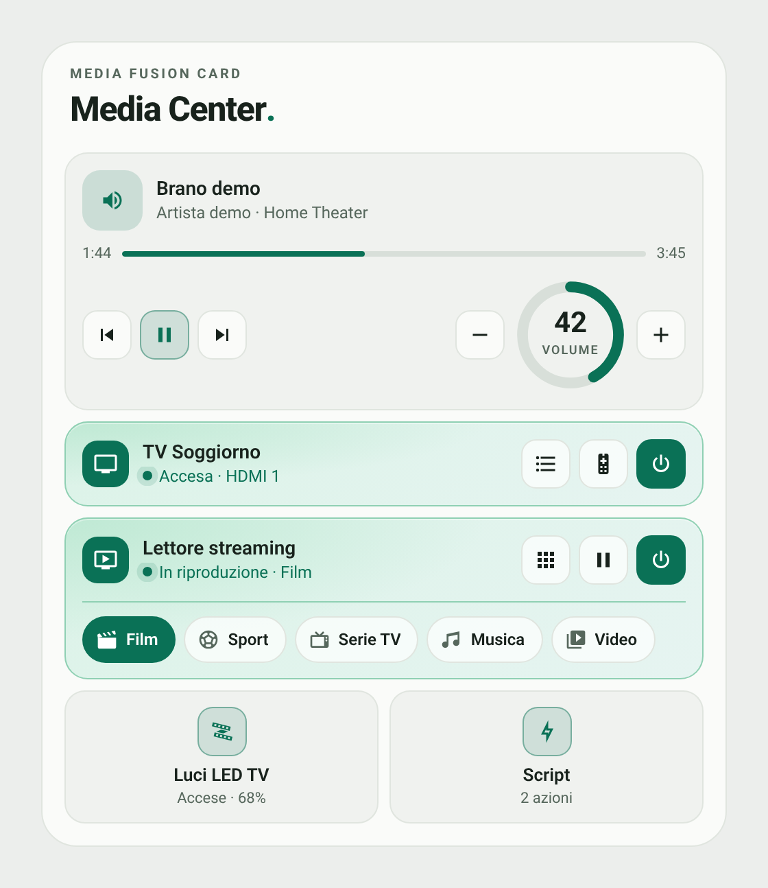
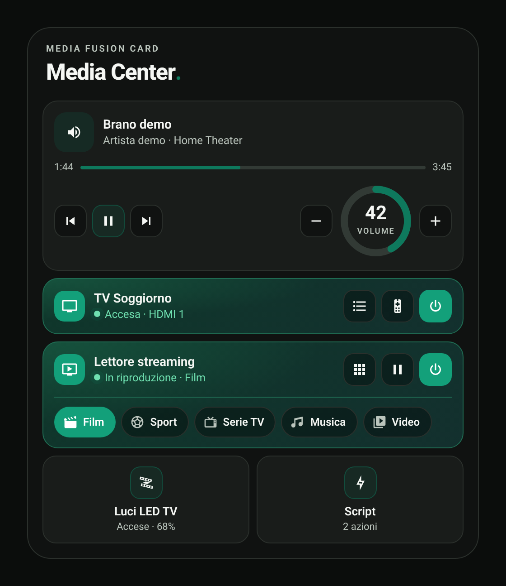
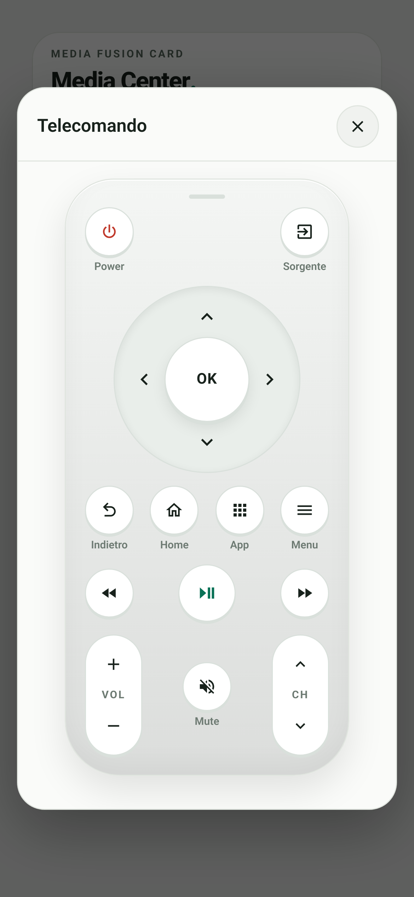
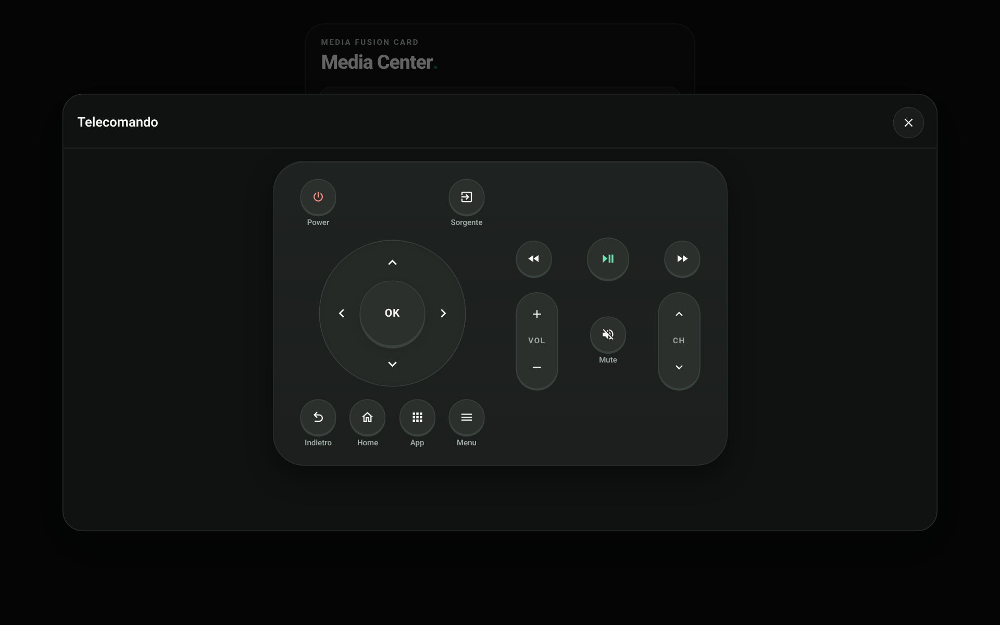
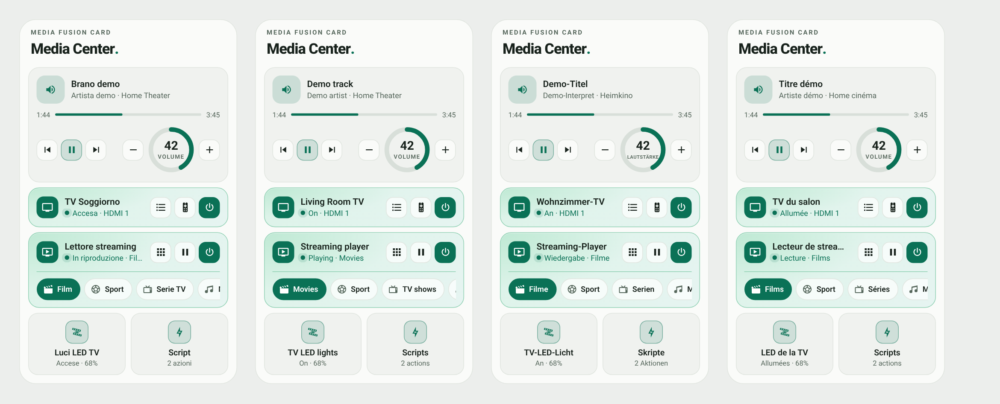

# Media Fusion Card

## Overview

**Media Fusion Card** is a modular dashboard card for Home Assistant that brings the controls of a media setup into one place: what is playing on your home theater, the TV, the streaming player and its apps, the TV LED lights and your own scripts. It uses a minimalist interface inspired by the Edera Light and Dark visual styles.

At the top, the **Playback** panel shows the current track with its controls and a volume ring with minus and plus buttons. Below it, the TV and the streaming player each have a compact row that turns green while the device is on. The LED lights and the scripts are two tiles that open their popup. A single remote controls both the TV and the streaming player.

The card is modular: use every section together, or add a single one to a dashboard on its own. The interface is available in Italian, English, German and French.

The card works with the entities already available in Home Assistant. It does not require a dedicated account, external services or additional libraries.

## Preview

  
  

| Phone popup | Tablet and desktop popup |
| --- | --- |
|  |  |

*Previews use fictional demo data, including the app names and the four interface languages (Italian, English, German and French). Displayed values and available controls depend on the configured Home Assistant entities.*

## Features

- **Playback panel:** Track, artist and artwork, a progress bar with position and duration, previous, play/pause and next. The volume ring has minus and plus buttons; tap the number to mute. The last volume set from the card is remembered in the browser when the entity does not report its volume level.
- **TV:** State and current source, a source selection popup, the remote and the power button. Power uses the on/off scripts you configure, or the entity's own turn on/off when it supports it.
- **Streaming player:** State and open app, play/pause, power and a row of apps that you choose. The open app is highlighted. Optional power through Android Debug Bridge (ADB).
- **Apps:** For each app you set an icon, a name and the app ID. Tapping an app opens it on the player. All apps are also listed in a popup.
- **Single remote:** One remote for the TV and the streaming player. Arrows, OK, Back, Home, Menu, rewind and fast forward go to the player when it is on and to the TV otherwise, or always to the one you choose. Power, source, volume, mute and channels always go to the TV.
- **LED lights:** A tile with the light's state and real colour. Its popup has the on/off switch and a brightness slider that sends the value while you move it.
- **Scripts:** A tile that opens the list of your actions, with a running state.
- **Colour when on:** The TV and streaming player rows turn green while the device is on. The rest of the card stays neutral. This can be turned off.
- **Modular:** The Playback panel and the TV, Streaming player, LED lights and Scripts modules can each be turned on or off and reordered.
- **Languages:** Italian, English, German and French. The language follows your Home Assistant profile (English when yours is not available) or can be set in the editor.
- **Popups:** Fixed-height popups, centred on the screen: tall and narrow on phones, wide with content in columns on tablets and desktop.
- **Clear states:** Unavailable, unknown and unsupported states are described in plain words, and controls that cannot work are disabled.
- **Visual configuration:** Three editor tabs, with native Home Assistant entity and icon selectors and a diagnostics view that shows which functions each entity supports.
- **Edera appearance:** Automatic, Light and Dark themes with native Home Assistant icons, for phones, tablets and desktop dashboards.

## Installation

### Marketplace (Recommended)

Install Media Fusion Card directly from the default Marketplace catalog in Home Assistant 2026.11 or newer.

1. Go to **Settings** > **Marketplace**.
2. The first time, accept the notice about community content.
3. Use **Search** to find **Media Fusion Card**.
4. Open the repository page and select **Install**.
5. Check the version in the dialog and select **Install** again to confirm.
6. Reload your browser to load the new resource.
7. Add **Media Fusion Card** to your dashboard and configure it using the visual editor.

### Manual installation

1. Download `dist/media-fusion-card.js` from the GitHub repository.
2. Copy it to the `www` directory of your Home Assistant configuration as `media-fusion-card.js`.
3. Open **Settings → Dashboards → Resources** in Home Assistant.
4. Add the following resource:

   `/local/media-fusion-card.js`

5. Select **JavaScript module** as the resource type.
6. Reload the dashboard and add the card.

If the `www` directory was just created, Home Assistant may need to be restarted before the file becomes accessible.

## Configuration and Usage

### Visual editor

Open a dashboard in edit mode, add **Media Fusion Card** and configure the three tabs:

- **Playback:** The audio entity, an optional name, the Playback panel, the progress bar and the artwork source.
- **Modules:** For each module, whether it is active, its position and its settings: TV entity, TV remote, turn-on and turn-off scripts and where the remote keys go; streaming player entity, its remote, ADB power, the apps row and the list of apps; the light entity; the scripts. The diagnostics view is at the end of this tab.
- **Appearance:** Top label, title, showing or hiding each of them, colour when on, theme and language.

Configurations created with earlier versions keep working.

### Apps on the streaming player

Each app needs an app ID. With the Android Debug Bridge integration (for example, a Fire TV), open the app on the player, then in Home Assistant go to **Developer tools → States**, select the player entity and copy the value of its `app_id` attribute. The card opens the app with `media_player.select_source`, passing the app ID as the source.

An app without an ID is opened by its name only when that name is in the player's source list. When no app is configured, the apps popup shows the player's own source list.

### The single remote

Open the remote from the TV row. The TV keys use the `remote` entity of the TV and send Samsung-style key codes (`KEY_*`). The streaming player keys use the player's `remote` entity when it is set; otherwise they are sent with `androidtv.adb_command` (Android key names such as `UP`, `CENTER` and `BACK`). A key is disabled when no route is configured for it. The **App** key opens the apps popup.

### Using a single module

Every module works on its own. To add only one to a dashboard, turn off the Playback panel in the **Playback** tab and leave a single module active in **Modules**. A module without its entity does not appear.

## Compatibility and Requirements

- Home Assistant with support for custom JavaScript dashboard cards.
- `media_player` entities for the home theater audio, the TV and the streaming player, as needed.
- Optional `remote` entities for the TV and the streaming player.
- A `light` entity for the LED lights and `script` entities for the actions, as needed.
- The Android Debug Bridge integration only for ADB power and for remote keys sent without a `remote` entity.

The card interface is available in Italian, English, German and French. Names of entities, sources and apps come from Home Assistant or from your settings and are not translated.

No specific minimum Home Assistant version has been independently verified for this repository.

The card does not require a dedicated paid service or additional remote JavaScript libraries.

## Privacy and Security

The card only calls Home Assistant services for the entities you configure: `media_player`, `remote`, `light` and `script` services, plus `androidtv.adb_command` for ADB power and for remote keys without a `remote` entity. It uses the permissions already available in Home Assistant and contains no telemetry, analytics, remote scripts or external assets.

The last volume set from the card is stored only in the browser of the device in use, separately for each entity.

## Releases

See the [GitHub Releases](https://github.com/luigi-regolo/media-fusion-card/releases) page for published versions.

## Copyright & License

Copyright © 2026 luigi-regolo.

Original project created and maintained by **luigi-regolo**.

Licensed under the **GNU General Public License version 3 only (GPL-3.0-only)**.

See the [LICENSE](LICENSE) file for the complete license terms.

The software is provided without warranty to the extent permitted by applicable law.
